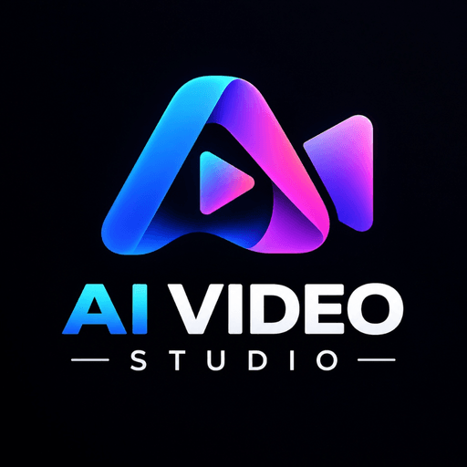
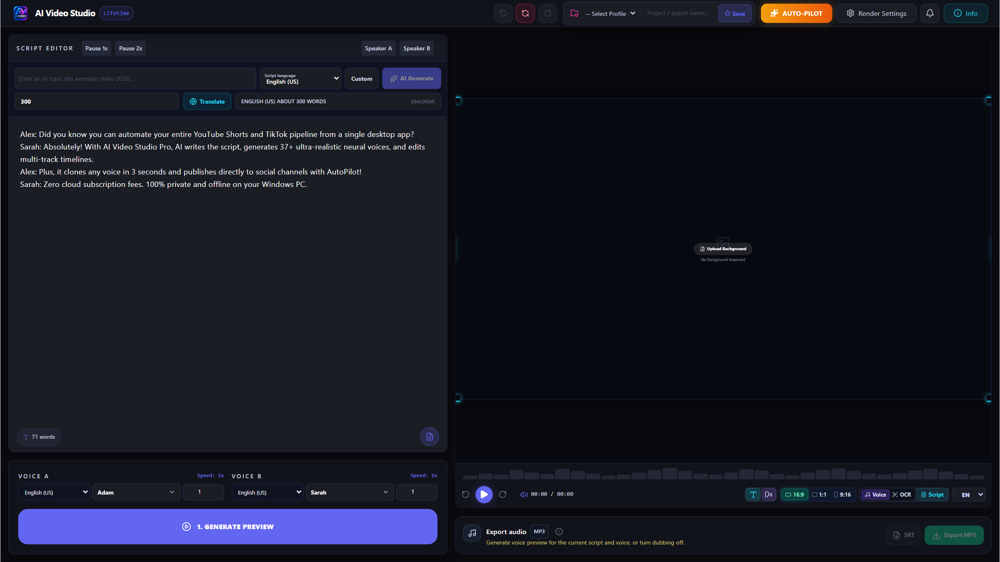
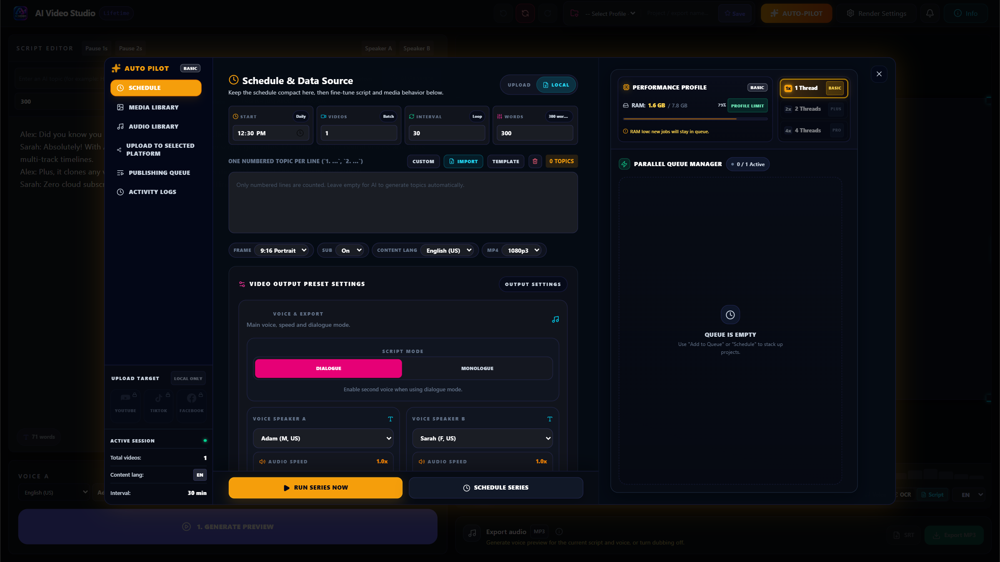

  

<h1 align="center">AI Video Studio Pro</h1>

  <strong>The Ultimate All-in-One AI Video Creation & Multi-Channel AutoPilot Studio</strong>

  <em>Generate viral, high-retention short-form and long-form videos for TikTok, YouTube Shorts, Facebook Reels, and Podcasts in seconds. Featuring multilingual studio-grade AI voices, zero-shot voice cloning, dual-speaker conversational scripting, automated karaoke subtitles, and 1-click batch publishing.</em>

  
  
  
  
  
  

---

  
  &nbsp;&nbsp;
  

---

  

---

## ⚡ Overview

**AI Video Studio Pro** is an all-in-one desktop production powerhouse designed for digital creators, media agencies, affiliate marketers, and automated content networks.

Unlike traditional cloud video platforms that charge expensive recurring credits and take minutes to render simple clips, AI Video Studio Pro runs **hyper-optimized local AI models directly on your Windows PC**—giving you unlimited high-speed rendering, zero cloud credit costs, and 100% private data processing.

---

## ✨ Core Highlights

### 🎭 AI Script Studio & Multi-Character Dialogue
* **Idea to Viral Script:** Automatically create engaging narratives, viral movie recaps, educational trivia, or high-converting affiliate copy with one click.
* **Dual-Character Conversation:** Natural back-and-forth dialogue mode (Speaker A & B) with distinct character personas, emotional cues, and alternating pacing.
* **Auto Scene Splitting:** Automatic scene timing and word-count estimation fine-tuned for vertical audience retention.

---

### 🎙️ Multilingual Studio-Grade AI Voices & Instant Voice Cloning
* **Extensive Multilingual Library:** Comprehensive studio-grade voice libraries across **English**, **Vietnamese** *(Northern, Central & Southern regional accents)*, **Spanish**, **French**, **German**, **Japanese**, **Korean**, **Chinese**, **Portuguese**, **Italian**, **Thai**, **Indonesian**, and more.
* **Specialized Tones & Personas:** Tailored vocal styles including viral movie review narrators, podcast co-hosts, dramatic storytelling, investigative documentaries, comedy banter, and broadcast commercials.
* **Zero-Shot Voice Cloning (3–8s):** Clone any human voice in just **3 to 8 seconds** from a clean reference audio sample—processed 100% locally on your PC.
* **Complete Vocal Nuance Control:** Adjust pitch, cadence, audio ducking, and emotional intensity per sentence or scene.

---

### 🎬 Multitrack Timeline & 4K 60FPS Video Engine
* **Dynamic Highlight Subtitles:** Automatic word-by-word animated captions in popular TikTok, CapCut, and Shorts aesthetics.
* **Intelligent Auto-Ducking:** Background audio attenuates automatically whenever speech or voiceover is detected.
* **Flexible Format Export:** Hardware-accelerated rendering in vertical **9:16** (Shorts, Reels, TikTok), square **1:1**, and horizontal **16:9** (YouTube, Facebook, TV) at up to **4K 60FPS**.

---

### 🤖 AutoPilot: 24/7 Automated Batch Production & Auto-Publisher
* **Autonomous Batch Queue:** Schedule and generate dozens of videos hands-free from customizable topics or spreadsheets.
* **Direct Multi-Channel Posting:** Connect accounts to automatically publish finished videos directly to **TikTok, YouTube Shorts, and Facebook Reels** on schedule.

  

---

## 💻 Hardware Compatibility & System Requirements

AI Video Studio Pro is engineered with multi-threaded architecture to perform reliably across a wide range of hardware configurations:

| Specification | Minimum Requirement | Recommended (Creator PC) | Pro Studio (4K & Batch) |
| :--- | :--- | :--- | :--- |
| **Operating System** | Windows 10 (64-bit) Version 1909+ | Windows 10 / 11 (64-bit) | Windows 11 (64-bit) Pro / Workstation |
| **Processor (CPU)** | Intel Core i3 / AMD Ryzen 3 (4 cores) | Intel Core i5 / i7 or AMD Ryzen 5 / 7 | Intel Core i7 / i9 or AMD Ryzen 7 / 9 (8+ cores) |
| **Memory (RAM)** | 8 GB RAM | 16 GB RAM | 32 GB RAM or higher |
| **Graphics (GPU)** | Integrated Graphics (Intel UHD / Iris / AMD Vega) | NVIDIA GeForce GTX 1650 / 1660 / RTX 3050 (4GB+) | NVIDIA GeForce RTX 3060 / 4070 / 4080 / 4090 (8GB+) |
| **Storage** | 3.5 GB free disk space (SSD) | Fast SATA / NVMe SSD | High-Speed NVMe M.2 SSD |
| **Target Output** | 720p / 1080p Generation & Neural Speech | 1080p 60FPS Video Export & Instant Voice Cloning | Ultra-Fast 4K 60FPS & Parallel AutoPilot Production |

---

## 🚀 Quick Start (3 Steps)

### 1. Download
Download the official lightweight setup:  
👉 **[AI-Video-Studio-Pro-Online-Setup.exe](https://github.com/anhviet-key/video-studio-file/releases/download/v1.0.10/AI-Video-Studio-Pro-Online-Setup.exe)** *(~193 KB)*

### 2. Install
Run `AI-Video-Studio-Pro-Online-Setup.exe`. The automated installer will configure the environment, set up the neural voice library, create a desktop shortcut, and launch the studio.

### 3. Create & Automate
* Choose **New Project** or load a template from your saved workspace.
* Enter a prompt or paste your text to generate a full dialogue script.
* Select from the multilingual voice library or clone your own voice in seconds.
* Hit **Render** or activate **AutoPilot** to automate daily publishing!

---

## 🔒 100% Privacy & Security

* **Local Speech & Voice Cloning:** Your voice reference samples and generated voice models are processed strictly on your computer and never uploaded to external servers.
* **Zero Telemetry Tracking:** Your proprietary scripts, media assets, and social credentials remain completely private.

---

## 📞 Support & Resources

* 💬 **Bug Reports & Inquiries:** [GitHub Issues](https://github.com/anhviet-key/video-studio-file/issues)
* 🌟 **Releases & Updates:** [GitHub Releases](https://github.com/anhviet-key/video-studio-file/releases)
* 📬 **Direct Contact:** support@videostudio.pro

---

  Copyright © 2026 AI Video Studio Pro. All rights reserved.

